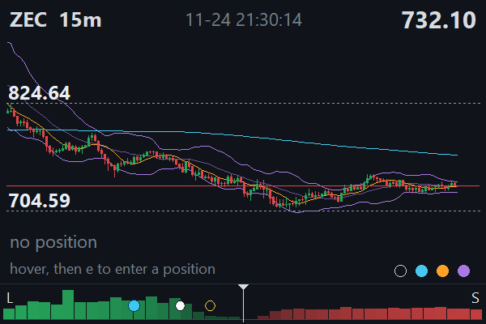
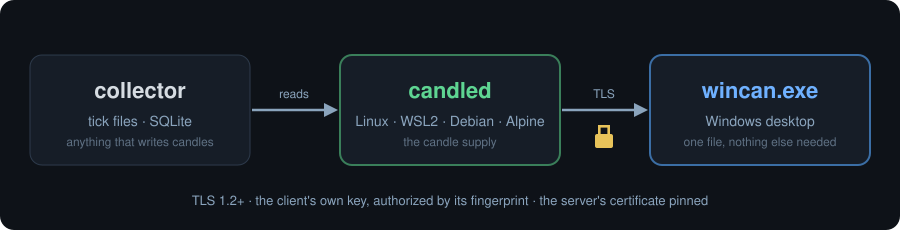
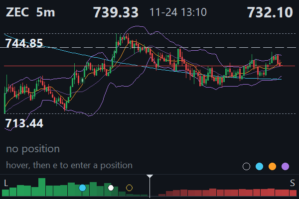
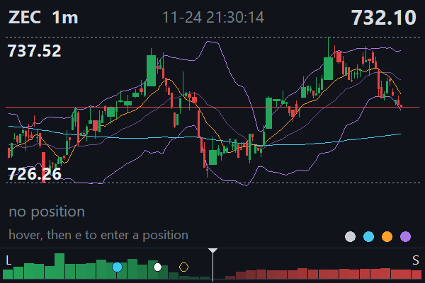
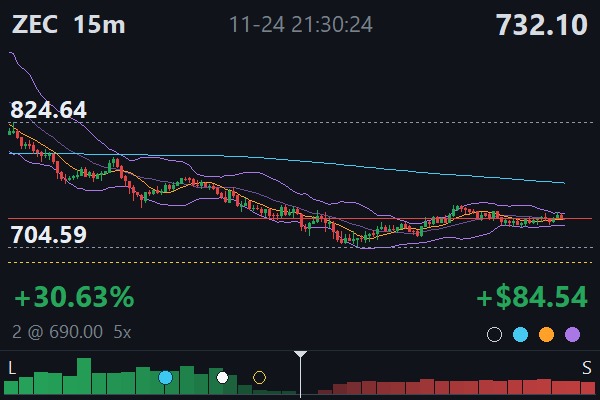
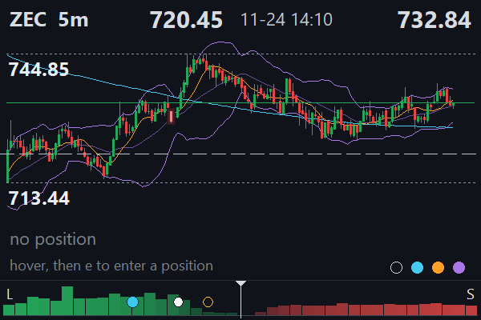
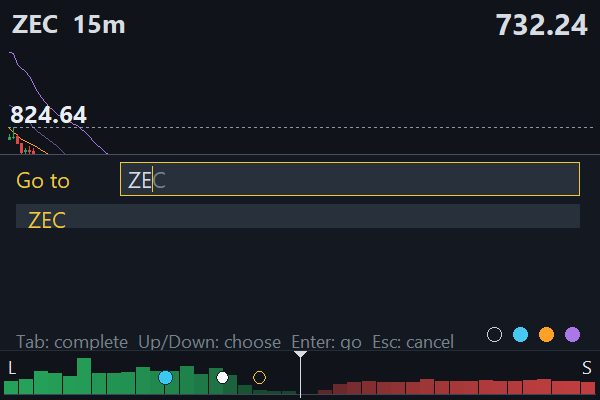
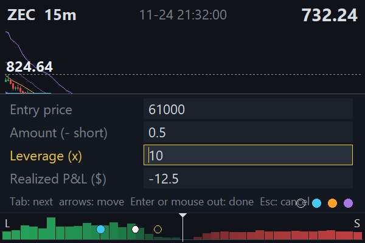
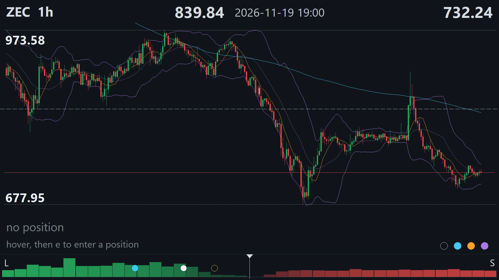
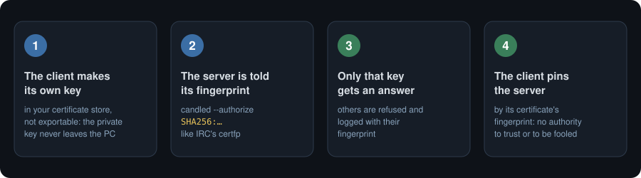

<div align="center">

# wincan

**A Windows GUI and a Linux server to view your stock and crypto charts in real time, and see your win/loss as it happens.**<br>
The chart is a small frameless window that stays on top of your desktop, or **full screen** at the press of `f` (and back exactly where it was). It is **keyboard driven**, and built for speed, responsiveness and good feel, with mouse input adding tasteful enhancements and never getting in the way (it takes the keyboard when you point at it, the pointer snaps to a candle and locks onto a line). The server is yours, and the two talk over an encrypted, key-authenticated connection.

[](COPYING)
[](https://github.com/moebiusV/wincan/releases/latest)




</div>

wincan is **two programs**:

| | what it is | where it runs |
|---|---|---|
| **`wincan.exe`** | the candle window: one file, no installer needed, nothing but Windows itself | the Windows desktop |
| **`candled`** | the candle supply: serves candles as JSON over TLS, to clients whose key it knows | Linux: Debian, Ubuntu, **WSL2**, Fedora and relatives, Alpine |

<p align="center"></p>

wincan only needs *a candle supply*. `candled` is one; anything that speaks the small
[candle protocol](man/candle-protocol.7) can be another.

## What you get

<table>
<tr>
<td width="50%"><br>
<sub><b>Look closely.</b> A line follows the mouse and shows the price under it; over a candle, that candle's date and time, with the candle lit up. The pointer <i>snaps</i> to a candle's middle and locks onto its open, high, low, close and onto the indicator lines.</sub></td>
<td width="50%"><br>
<sub><b>Volume candles</b> whose width follows volume, laid side by side the way an exchange draws them (a rule measured against real charts).</sub></td>
</tr>
<tr>
<td><br>
<sub><b>Your position.</b> Entry, size, leverage and realized P&amp;L; unrealized profit in dollars and as return on margin, at the mark price. <code>x</code> closes the trade and logs it with the best and worst it went through.</sub></td>
<td><br>
<sub><b>Liquidation heat strip.</b> Modelled long (green, left) and short (red, right) liquidations, one bar per percent from the price; hover a bar for its percent range and price range.</sub></td>
</tr>
<tr>
<td><br>
<sub><b>Go to any coin</b> with <code>g</code>: type a few letters, Tab completes, Enter goes.</sub></td>
<td><br>
<sub><b>The position editor</b> (<code>e</code>): entry, amount (negative for a short), leverage, realized P&amp;L.</sub></td>
</tr>
</table>

<details>
<summary><b>Full screen</b> (<code>f</code>): the chart fills the monitor and goes back exactly where it was</summary>
<br>

</details>

### Features

- **Chart**: candles with nine timeframes (1m 3m 5m 15m 30m 1h 4h 1d 1w), the last price, the high and low on show, Bollinger bands (20, 2), 9- and 200-period moving averages, volume candles.
- **Small and always there**: 300×175 pixels, no frame, always on top, never takes your keyboard until your mouse is over it, and gives it back when the mouse leaves. Tray icon and <kbd>Ctrl</kbd>+<kbd>Alt</kbd>+<kbd>C</kbd> hide and show it. Snaps to the screen edges. Resizable from 75% to 400%.
- **Full screen** on one key, restored to the exact place and size whatever ends it (Esc, another window, the tray, a display change).
- **Positions**: profit or loss in dollars and per cent, leverage and realized P&L, a trade log (`%APPDATA%\wincan\trades.csv`).
- **Precise reading**: price under the mouse, the date and time of the candle, the pointer that snaps to candle centres and locks onto OHLC and indicator lines, held until your real motion would have left.
- **Secure by design**: TLS 1.2+, a key of your own that never leaves your computer, the server's certificate pinned. See below.
- **Lean**: one executable, only Windows' own libraries; the server is a few thousand lines of C.

## Install

### Windows: the window

Download `wincan-1.1.1-win64.zip` from the [latest release](https://github.com/moebiusV/wincan/releases/latest), unpack it, open PowerShell in the unpacked folder, and run:

```powershell
powershell -ExecutionPolicy Bypass -File install.ps1 -Server https://HOST:8766 -ServerPin SHA256:... -Launch
```

You do not need the installer: **just run `wincan.exe`**. The first time, it asks where the candles come from, offers to make this
computer's key (one Yes or No), and puts the `candled --authorize ...` command on your clipboard for the server's administrator.
`wincan.exe --gen-key` does it without asking. The installer adds the Start Menu entry and Win+R and can do the same up front.

No administrator rights are needed. It puts `wincan.exe` in `%LOCALAPPDATA%\Programs\wincan`, adds a Start Menu entry and
**Win+R** `wincan`, makes this computer's key, and prints its fingerprint for the server's administrator to authorize.
`-Server` and `-ServerPin` are what the server's installer prints. `-DryRun` shows what it would do; `uninstall.ps1` removes it.
([windows/README.txt](windows/README.txt))

### Linux (Debian, Ubuntu, Fedora, Alpine, WSL2): the candle supply

```sh
tar xf wincan-1.1.1.tar.gz && cd wincan-1.1.1
sudo sh linux/install-candled.sh          # builds, installs, makes the service user and the server key, starts the service
```

It detects `apt`, `dnf`/`yum`, `zypper`, `apk` (and installs the build dependencies if you let it), uses **systemd** or **OpenRC**,
and on **WSL2 without systemd** tells you how to start candled (or turns systemd on in `/etc/wsl.conf`, with a backup, if you ask).
At the end it prints the **server fingerprint** and the command to authorize a client. Or do it yourself: `./configure && make && sudo make install`.
On Debian and Ubuntu, `dpkg-buildpackage -us -uc -b` makes proper packages.

### WSL2 and Windows on one machine

```sh
sudo sh linux/install-candled.sh                      # candled listens on 127.0.0.1, which Windows reaches as localhost
powershell.exe -ExecutionPolicy Bypass -File "$(wslpath -w /usr/local/share/wincan/windows/install.ps1)" \
    -Server https://localhost:8766 -ServerPin SHA256:...the one it printed... -Launch
sudo candled --authorize SHA256:...the one the Windows installer printed...
```

## Security: keys, not passwords

<p align="center"></p>

candled has **no passwords**. It works the way an IRC bouncer handles a client certificate (`certfp`, SASL EXTERNAL):

1. The **client makes its own key** and self-signed certificate (the installer does it, in your certificate store, not exportable). The private key never leaves your computer.
2. The **server is told the SHA-256 fingerprint** of the client's certificate: `candled --authorize SHA256:…` (any usual way of writing it is accepted).
3. A client whose fingerprint is not on the list **gets no answer**; the refusal is logged with its fingerprint, which is what you pass to `--authorize`.
4. The client **pins the server's certificate** by its fingerprint, so there is no certificate authority to trust and nothing to be fooled by.

Everything is TLS 1.2 or later, and **there is no fallback to plain HTTP**, in either program: a client and its server speak TLS or nothing. candled listens on **127.0.0.1** by default and refuses to serve plain HTTP on any other address unless you say `insecure yes`; wincan refuses plain HTTP to any host but this computer.
([candled(8)](man/candled.8), SECURITY)

## Using wincan

| key | does |
|---|---|
| ↑ ↓ | the timeframe |
| ← → | the coin (`g` to go to one by name) |
| `e` | the position editor (entry, amount, leverage, realized P&L); `x` closes the trade at the mark and logs it |
| `f` | full screen; again, or Esc, puts it back |
| `+` `-` | the size of the window (in full screen, of the text) |
| `t` | hide to the tray; <kbd>Ctrl</kbd>+<kbd>Alt</kbd>+<kbd>C</kbd> shows or hides from anywhere |
| `q` | quit |
| mouse | over the window it has the keyboard; click and drag moves it (snapping to the screen edges); the four dots at the bottom right toggle Bollinger, the 9 and 200 averages, and volume candles |

The settings are in `%APPDATA%\wincan\wincan.ini`; see [wincan(1)](man/wincan.1) and [wincan(5)](man/wincan.5).

## Configuring candled

`/etc/candled.conf`, in [obconf](https://github.com/moebiusV/hbnf/blob/main/obconf.md) notation; the defaults are safe:

```
listen 127.0.0.1
port 8766
tls yes
certificate "/etc/candled/server.crt"
key "/etc/candled/server.key"
authorized "/etc/candled/authorized-clients"
candles "/var/lib/candled/candles"
# backfill "...", database "...", live-bins "...", heat-db "...", official-klines yes
```

See [candled.conf(5)](man/candled.conf.5). Check a file with `candled --check-config`. The parser is generated by
[hbnf](https://github.com/moebiusV/hbnf) from [`grammars/candled.hbnf`](grammars/candled.hbnf) and committed, so building needs no hbnf.

## A candle supply of your own

wincan asks for `/pairs`, `/candles`, `/range` and `/heat` and gets JSON; the whole protocol is one page,
[candle-protocol(7)](man/candle-protocol.7). `candled` reads the binary files a collector writes to disk, 100 ms candles with a time marker every minute, or a file of one-minute
records, in the exact formats of [candled-data(5)](man/candled-data.5) ([`contrib/candle-writer.py`](contrib/candle-writer.py) writes them, as an example); a script that answers
those four requests is enough.

## Building

```sh
./bootstrap            # only from a git checkout (needs autoconf and automake); a release tarball has configure
./configure && make && make check && sudo make install
make distcheck         # the release check: build, test, install and uninstall from a fresh tarball
```

`wincan.exe` is cross-built with MinGW-w64 (`x86_64-w64-mingw32-gcc`) when it is found. GNU packaging throughout: standard
targets, `DESTDIR`, `--prefix`/`--sysconfdir`, man pages for every program and file format. See [INSTALL](INSTALL) and [HACKING](HACKING).

## Status

Developed on Windows against a Linux candle server; the server is built, tested and packaged on Ubuntu (under WSL2).
Tested packaging: Debian and Ubuntu. RPM ([`contrib/wincan.spec`](contrib/wincan.spec)) and Alpine
([`contrib/APKBUILD`](contrib/APKBUILD)) packaging are written and **not yet tested** on those systems: reports and fixes welcome.

## Credits and licence

By David Walther. Licensed under the [GNU GPL, version 3 or later](COPYING). The configuration parser was generated by
[hbnf](https://github.com/moebiusV/hbnf) (ISC licence for its runtime). The certificate-fingerprint model follows IRC's certfp as
[soju](https://soju.im) uses it.

Bugs and ideas: [issues](https://github.com/moebiusV/wincan/issues).
